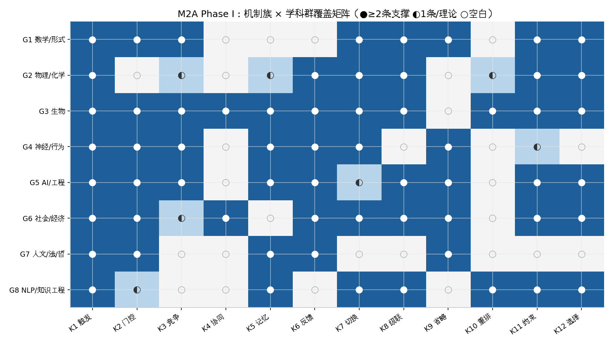
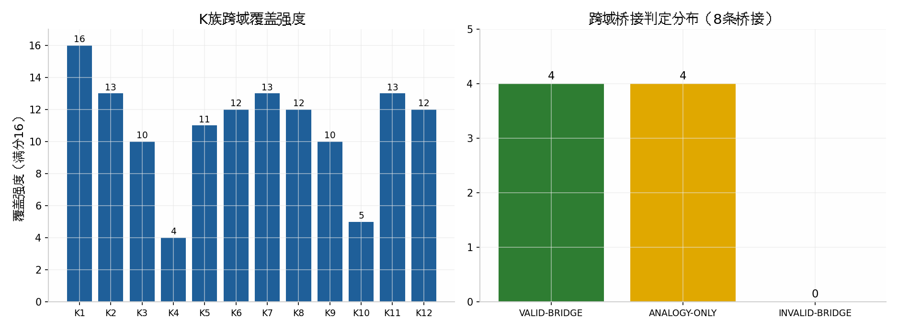

# M2A Preliminary Theory Report（Phase I 初步理论报告）

> 版本 v1.0 ｜ 2026-10-17 ｜ 中文（导师审阅版）
> 项目：M2A（Motion to Action）跨学科 Phase I 文献研究
> 配套文件：`../00_CHARTER_AND_BOUNDARIES.md` – `../07_CONTRADICTIONS_AND_COUNTEREVIDENCE.md`、
> `../literature/bibliography_registry.md`（87 条注册文献）、
> `../literature/source_verification_log.md`、`../governance/NEGATIVE_AND_NULL_EVIDENCE_LOG.md`

## 1. 摘要与核验声明

本报告回答框架 v0.2 的核心问题——"What Really Brings to Act?"——在 Phase I 高质试点
范围内的阶段性答案。工作覆盖 8 大学科群（数学形式、物理化学、生物、神经行为、
人工智能与工程、社会经济、人文法律哲学、NLP 与知识工程），共注册并核验 **87 条**
文献（24 条种子 + 63 条扩展），每集群 7–10 条，全部完成 DOI/来源双通道核验，全部
完成 K 族机制标注与一句话机制分析。方法上采用 PRISMA-ScR 范围综述口径（PCC 问题、
纳入排除规则、双通道核验规程），但如实声明：本阶段未执行正式数据库结构化检索与
双人独立筛选，属于"高质试点"而非完整系统综述。

**核验上限声明（不可省略）**：87 条中 85 条为 IDENTITY_VERIFIED，2 条另达
ABSTRACT_VERIFIED（R13、R23）；**没有任何一条达到 FULLTEXT_REVIEWED 或
CLAIM_INDEPENDENTLY_CHECKED**。因此本报告的一切机制结论均为"题录与摘要级证据支持
的结构判定"，而非全文审查后的结论；报告中所有定量数字（如约 28% 意向方差、350 ms
 readiness potential 先行）均转引自所注册文献自身的摘要或公认表述，未由本阶段独立
复现。这一上限写进每一条 Phase II 移交事项，防止下游工作越级引用。

## 2. 核心问题的阶段性答案

跨 87 条证据的结构性回答是：**没有任何单一机制带来行动；行动是多个机制族在特定
层上的合取结果，且"不行动"有与"行动"同样多的机制**。触发（K1）在全部 8 个集群都有
机制级表述，但几乎从不单独充分：T 细胞需要 TCR 与 CD28 双信号（[Chen & Flies 2013](https://doi.org/10.1038/nri3405)），
证据需积累越阈（[Gold & Shadlen 2007](https://doi.org/10.1146/annurev.neuro.29.051605.112851)），
采纳行为在复杂传染中需要多重来源确认（[Centola 2010](https://doi.org/10.1126/science.1185231)）。
抑制门（K2）、反馈（K6）、切换（K7）与资源约束（K11）与 K1 并列构成骨干——
覆盖矩阵（图 1）显示 K1/K11 覆盖强度 16/16 满分，K2/K7/K8 各 13/16，而协同（K4，
4/16）与角色重排（K10，5/16）是最薄弱环节。这一分布本身就是发现：跨学科文献对
"什么阻止行动"和"什么消耗行动成本"的共识，远深于对"什么协同促成行动"的刻画。

第二个结构性发现是 **K9 省略/弃权族的分布不对称**：它在形式科学、神经行为、社会
经济、人文法律与工程中都有直接条目（满意化、意向—行为缺口、道德风险、法律不作为、
奖励黑客），但在物理化学层为零覆盖。由此产生一个可检验的 M2A 工作假设（登记为
M2A_HYPOTHESIS，非结论）：**"省略"作为机制可能依赖表征系统——只有当系统能表征
"本可行动"时，不行动才成为机制对象而非 mere absence**。该假设在 Phase II 中有明确
的证伪路径：寻找无表征系统中具有省略结构（选择性不响应特定输入）的物理化学实例。

## 3. 支撑机制：分族证据表

下表汇总各机制族的最强证据条目（完整 87 条见注册表）。证据类型缩写：FT=形式定理、
CI=因果干预、OB=观察、SI=模拟、IN=诠释、AN=类比。

| K族 | 代表证据（条目） | 证据类型 | 跨域强度 | 关键限定 |
|---|---|---|---|---|
| K1 触发 | G4-04 证据累积越阈（OB/SI）；G8-04 ACE 触发词规范（IN-资源）；G4-03 RPE 调制（CI） | CI/OB/SI | 8/8 集群 | 触发常需合取（见 K4）；意识触发未决（C-01） |
| K2 门控 | R09/G3-02 免疫检查点（CI-综述）；G4-01/02 no-go（SI+临床）；R20 CBF（FT）；G5-03 拒绝方向（CI-受限） | FT/CI/SI | 7/8 集群 | 工程门可证明、生物门可干预，强度类型不同（B-04）；G5-03 降权（C-04） |
| K3 竞争 | G4-01 基底节选择（SI）；G3-01 双稳竞争（CI）；G4-07 想要/喜欢分离（OB） | SI/CI/OB | 5/8 集群 | 竞争可发生在系统内不同层级 |
| K4 协同 | R09/G3-03 共刺激 AND 门（CI-综述）；R21/G6-03 复杂传染多重确认（SI+实验） | CI/实验 | 3/8 集群 | **覆盖最弱**；Phase II 优先扩展 |
| K5 延迟/记忆 | R13 延迟进食反馈（CI）；R14 奖励间隔（CI+勘误）；R15 时间尺度不变性（FT+OB，冻结）；G5-06 信念状态（FT）；G8-08 事件链（SI） | CI/FT/SI | 6/8 集群 | 与 K6 分挂（C-03）；时间结构不可约减 |
| K6 反馈 | G4-03 多巴胺 RPE（CI）；R19 TD 学习（FT）；G5-01/G5-09 RLHF/偏好（实验）；G3-04 稳态应变（OB） | CI/FT/实验 | 7/8 集群 | 规范错配时反噬（G5-04）；FEP（R12）为竞争者框架 |
| K7 切换/滞回 | R07/G3-01 双稳态（CI）；G4-02 go/no-go 分离（临床）；G2-06 BZ 振荡（实验）；G6-01 损失域切换（实验）；G6-08 偏好伪装雪崩（理论+案例） | CI/实验 | 6/8 集群 | 近因/远因须分层（C-07） |
| K8 级联 | R21/G6-02/G6-03 扩散正反案例对；G2-06 化学振荡；G3-05 基因调控级联；G1-04 Schelling 涌现 | 实验/SI | 6/8 集群 | 方向取决于传染类型（C-02） |
| K9 省略 | G4-06 意向—行为缺口（元分析）；G1-06 满意化（理论）；G6-05 道德风险（FT）；G7-07 法律不作为（IN）；G5-04 奖励黑客（理论） | 元分析/FT/IN | 5/8 集群 | 物理化学层零覆盖（工作假设 O-03） |
| K10 角色重排 | G8-01/02 PropBank/VerbNet（资源）；G3-05 细胞命运（IN）；G8-06 Wikidata（资源） | 资源/IN | 2/8 集群 | **覆盖次弱**；语言学资源最成熟 |
| K11 资源约束 | R03 信道容量（FT）；R05/G2-01 耗散功（FT）；G3-04 适应负荷（OB）；G1-06 搜索约束（理论）；G5-06 部分可观测（FT） | FT/OB | 8/8 集群 | 硬约束（物理）与软约束（认知/社会）不可混定量 |
| K12 选择/适应 | R19 策略选择（FT）；G2-04/05 运动模式等价/耗散适应（FT+综述）；G6-06 创新适配（系统综述）；G3-06 Tinbergen 框架（纲领） | FT/综述 | 6/8 集群 | 与近因机制分层；演化解释单独挂 |

图 1（覆盖矩阵）与图 2（覆盖强度、桥接判定）见 `../assets/`。

## 4. 反例与矛盾（报告级摘要）

完整登记册见 `../07_CONTRADICTIONS_AND_COUNTEREVIDENCE.md`（C-01 至 C-08），此处只
陈述对理论建构有直接约束的五条。第一，**意识触发未决**（C-01）：Wegner 的实验表明
意志感可被事后操纵（[Wegner 2002](https://direct.mit.edu/books/monograph/2829)），
Libet 的电位测量表明大脑启动先于报告意愿（[Libet 1985](https://doi.org/10.1017/S0140525X00044903)），
而 Davidson 的理由因果论仍是行动概念分析的强立场——M2A 事件语法第一槽因此保持
开放参数化。第二，**扩散机制的方向性**（C-02）：弱连接在简单传染中促进扩散、在
复杂传染中失效，同族机制 D 轴方向随协同条件反转，这要求一切 K8 标注必须附带传染
类型参数。第三，**反馈的时间结构**（C-03）：R14 与 R15 共同表明奖励间隔与时间尺度
不变性是经典折扣回报模型之外不可约减的维度。

第四，**工程结论的适用面**（C-04）：Arditi 的"拒绝由单方向介导"结论仅在 13 个
RLHF/DPO 对齐的开源聊天模型上检验，且已遭"概念锥"批评（arXiv 2502.17420），
本阶段将其 K2 标注降为 ◐ 并转 Phase II 复现候选。第五，**意向预测力上限**
（C-06）：Sheeran 的元分析显示意向仅解释行为方差约 28%（Sheeran 2002，Eur. Rev. Soc. Psychol. 12(1):1–36，详见注册表 G4-06），
这一数字不证伪计划行为理论，但为一切"意图→行动"直推链条设定经验上限。以上每条
矛盾都未被调和删除，均带裁定状态留档。

## 5. 有效跨域映射（桥接判定摘要）

八条候选桥接的完整论证见 `../06_MECHANISM_BRIDGE_REGISTRY.md`。判定结果：
**VALID-BRIDGE 四条**（均有条件）、**ANALOGY-ONLY 四条**、INVALID 零条。
最有价值的有效桥是 B-03 反馈驱动学习：强化学习的 TD 公理（R19）、多巴胺 RPE
假说（G4-03）与 RLHF/偏好反馈（G5-01、G5-09）共享同一数学骨架——预测误差信号
乘以可塑性规则——且人工侧与生物侧各自有因果证据；但"多巴胺 = TD 误差"这一桥
本身仍是假说级，按章程不得标 SUPPORTED_MECHANISM。B-05（扩散级联，社会侧内部
正反案例对成立）、B-06（资源约束，五实例共享"约束塑形可达行动集"的存在性主张）、
B-08（省略，概念层共享行动集内跳过结构）为弱有效桥。四条仅类比桥（B-01 阈值、
B-02 滞回、B-04 抑制门、B-07 记忆）的共同教训是：**功能趋同在多个域反复出现，
并不构成机制同构的证据**——这恰是框架 v0.2 §6"类比≠已证成普遍机制"条款的
第一批实证注脚。

## 6. Phase II 验证候选（移交清单）

1. **R13 全文级核验**（需机构访问或作者存档版），并核定 R14 Publisher Correction
   对定量结论的影响（V-03）。
2. **Arditi 拒绝方向跨架构复现**：闭源模型、非对齐基座模型上检验单方向假说（C-04）。
3. **K4/K10 扩展检索**：协同门与角色重排族的覆盖补强（G-01、G-02）。
4. **K9 物理化学实例检验**：证伪或支持"省略需表征系统"工作假设（O-03）。
5. **意识触发参数化实验设计**（仅设计，不实施——新实验需另行授权）：基于 C-01
   裁定，设计区分"神经因果链触发"与"理由归属触发"的可观察量。
6. **制度滞回的定量刻画**：为 B-02 寻找路径依赖的可测指标（cf. 社会经济文献）。
7. 若升级为系统综述：补 PRISMA-S 全项（结构化数据库检索、双人筛选、检索式存档）。

## 7. 局限与治理遵守情况

本阶段的诚实上限有四。其一，核验级别最高仅 ABSTRACT_VERIFIED（见 §1），一切结论
为结构判定。其二，检索为种子滚雪球加主题补全，非结构化数据库检索，存在选择偏差
风险，已通过双通道核验与弃用登记（Wald 1949、Waddington 1957、Redgrave 1999 三条
DROPPED-CANDIDATE）部分对冲。其三，87 条均为英文载体文献，非英语学术传统
（如大陆的现象学行动理论、日文的过劳与行动研究）未覆盖，构成文化视角缺口。
其四，机制分析为注册表级一句话分析，未做逐篇的全文编码，K 族标注可能低估每篇
文献内部的机制多样性。治理方面：章程五条冻结条款全部遵守；无新实验、无动物/
人体实验、无付费算力、无模型训练；PNAS 冻结资产（R15）仅核验不解读；消极与矛盾
证据全部登记于负面日志与矛盾登记册，数量上负面/限定类登记（8 条矛盾 + 8 条负面
结果 + 4 条图谱空白 + 4 条桥接降级）与正面机制表同等篇幅呈现。

## 8. 图表

- 图 1：`../assets/matrix_k_cluster.png` — 机制族 × 学科群覆盖矩阵（●/◐/○）。
- 图 2：`../assets/k_strength_and_bridges.png` — K 族覆盖强度（满分 16）与桥接判定分布。

## 9. 结论

Phase I 的回答可以浓缩为三句话。第一，行动由机制组合带来而非单一机制带来，
K1 几乎从不单独充分，骨干是 K1+K2+K6+K7+K11 的合取结构；第二，跨域有效映射
稀少且全部带条件（4/8 桥有效、4/8 仅类比、0 无效），"运动→行动"问题在跨学科
层面是可分解的但尚不可统一；第三，"不行动"是有独立机制谱系的一等现象，
其是否需要表征系统是本阶段产生的最有新意的工作假设。以上全部结论受 §1 核验
上限约束，供导师审阅并决定 Phase II 的授权范围。
